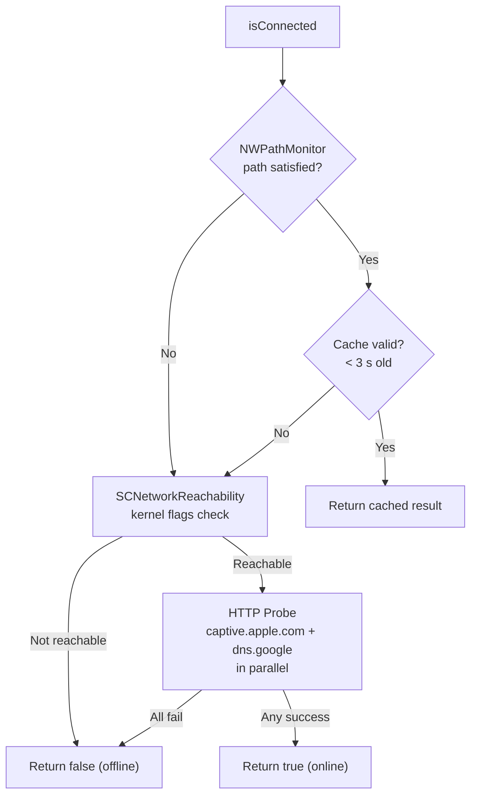

# SwiftJutsu — JutsuKit

A lightweight Swift Package designed primarily for iOS apps that need a clean dependency injection container, structured logging, JSON utilities, and a robust Alamofire-backed networking layer. This library is using Modern Swift Concurrency from the ground up.

## Table of Contents

- [SwiftJutsu — JutsuKit](#swiftjutsu--jutsukit)
  - [Table of Contents](#table-of-contents)
  - [Requirements](#requirements)
  - [Installation](#installation)
    - [Swift Package Manager](#swift-package-manager)
  - [Modules](#modules)
    - [CoreJutsu](#corejutsu)
      - [Dependency Injection — `DIC`](#dependency-injection--dic)
      - [Error Types — `JutsuError`](#error-types--jutsuerror)
      - [JSON Utilities — `JsonResolver`](#json-utilities--jsonresolver)
      - [Logging — `dlog`](#logging--dlog)
      - [Module Toggle](#module-toggle)
    - [NetworkJutsu](#networkjutsu)
      - [Network Service — `AlamoNetworkService`](#network-service--alamonetworkservice)
      - [Connection Checker — `NetworkConnectionChecker`](#connection-checker--networkconnectionchecker)
      - [Types — `NTKEncoding` \& `NTKRequestMethod`](#types--ntkencoding--ntkrequestmethod)
  - [Usage Examples](#usage-examples)
    - [Register \& Resolve a Service](#register--resolve-a-service)
    - [Make a Network Request](#make-a-network-request)
    - [Instantiate With Custom Config](#instantiate-with-custom-config)
    - [Check Internet Connectivity](#check-internet-connectivity)
    - [Structured Logging](#structured-logging)
  - [License](#license)

---

## Requirements
| Platform | Minimum Version |
|----------|----------------|
| iOS      | 16.4           |
| macOS    | 12.0           |
| Swift    | 5.10           |

---

## Installation
### Swift Package Manager
Add the package to your `Package.swift` dependencies:

```swift
dependencies: [
    .package(url: "https://github.com/danielprast/swiftjutsu.git", from: "1.0.0"),
],
targets: [
    .target(
        name: "YourTarget",
        dependencies: ["JutsuKit"]
    ),
]
```

Or in **Xcode**: go to **File → Add Package Dependencies…**, paste the repository URL, and add `JutsuKit` to your target.

---

## Modules
### CoreJutsu
The foundation module. No external dependencies — only Apple frameworks.

---

#### Dependency Injection — `DIC`
`DIC` is a lightweight, `@MainActor`-bound dependency injection container. Services are registered by type and resolved on demand via factory closures.

```swift
// Protocol — accept in your own types for testability
public protocol DICProtocol {
    func register<Service>(type: Service.Type, factoryClosure: @escaping ServiceFactory)
    func resolve<Service>(type: Service.Type) async -> Service?
    var isEmptyContainer: Bool { get async }
}
```

| API | Description |
|-----|-------------|
| `DIC.shared` | Singleton instance (type-erased to `DICProtocol`) |
| `register(type:factoryClosure:)` | Stores a factory closure keyed by the service type name |
| `resolve(type:)` | Calls the factory and casts the result to `Service` |
| `isEmptyContainer` | Returns `true` when no services have been registered |

> [!NOTE]
> `DIC` is annotated `@MainActor`, so all registration and resolution happens on the main thread. Use `await DIC.shared.resolve(type:)` from any async context.

---

#### Error Types — `JutsuError`
A unified `LocalizedError` enum used across both modules.

| Case | Meaning |
|------|---------|
| `.custom(String)` | Caller-supplied message |
| `.errorDataBody(Data)` | Raw response body (e.g. 403) |
| `.parsingError` | JSON decoding failed |
| `.invalidResponse` | No or unrecognized HTTP response |
| `.connectionProblem` | Network not reachable |
| `.timeoutRequest` | Request timed out |
| `.unauthorized` | HTTP 401 |
| `.internalServerError` | HTTP 5xx |

`JutsuError` conforms to `Equatable` and `Hashable`, making it safe to use in sets, dictionaries, and switch statements.

---

#### JSON Utilities — `JsonResolver`
A stateless `struct` with static helpers for common JSON tasks.

| Method | Description |
|--------|-------------|
| `decodeJson(from:outputType:)` | Decodes `Data` into any `Codable` type |
| `createData(from:)` | Serializes a `[String: Any]` dictionary to `Data` |
| `createData(fromString:)` | Converts a UTF-8 `String` to `Data` |
| `parseDataToJson(_:)` | Deserializes `Data` into `[String: Any]` (arrays are wrapped under `"data"` key) |
| `encodeToJson(dictionary:)` | Pretty-prints a `[String: Any]` dictionary to a JSON `String` |
| `readJsonFileFromResource(bundle:fileName:)` | Loads a `.json` file from a `Bundle` resource |

---

#### Logging — `dlog`
A structured logging function built on top of Apple's `OSLog` framework (iOS 17+ / macOS), with a `print` fallback for older OS versions.

```swift
public func dlog(
    _ key: String,
    _ value: Any,
    type: DLogType = .info,
    subsystem: String = "module",
    file: String = #fileID,
    function: String = #function,
    line: Int = #line
)
```

**`DLogType`**
| Case | Emoji | OSLog Level |
|------|-------|-------------|
| `.info` | 😎 | `info` |
| `.warning` | ⚠️ | `warning` |
| `.error` | 📛 | `critical` |

A test-friendly variant `dlogTest(_:_:domain:type:)` is also provided — it always uses `print` and accepts an optional domain label.

---

#### Module Toggle

```swift
// Disable all JutsuKit logs globally
toggleJutsuLog(enabled: false)

// Re-enable
toggleJutsuLog(enabled: true)
```

The `jutsuLogEnabled` variable controls `dlog` output across the entire package.

---

### NetworkJutsu
Builds on top of **CoreJutsu** and [Alamofire 5.10.2](https://github.com/Alamofire/Alamofire) to provide a ready-to-use async networking layer.

---

#### Network Service — `AlamoNetworkService`
A Swift `actor` that wraps an Alamofire `Session` and exposes two async throwing methods.

```swift
public actor AlamoNetworkService {
    public init(urlSessionConfiguration: URLSessionConfiguration = .default)
}
```

**`performRequest<T>` — Decode directly to a `Decodable` model**
```swift
public func performRequest<T: Decodable>(
    decodable: T.Type,
    url: URL,
    method: NTKRequestMethod,
    headers: [String: String]? = nil,
    parameters: [String: Any & Sendable]? = nil,
    encoding: NTKEncoding
) async throws -> T
```

**`performRequestData` — Return raw `Data`**
```swift
public func performRequestData(
    url: URL,
    method: NTKRequestMethod,
    headers: [String: String]? = nil,
    parameters: [String: Any & Sendable]? = nil,
    encoding: NTKEncoding,
    timeout second: TimeInterval = 10,
    responseValidation: ((Data?, HTTPURLResponse) throws -> Data)? = nil
) async throws -> Data
```

Pass a custom `responseValidation` closure to override the built-in HTTP status code handling.

**Built-in HTTP Status Handling**

| Status Code | Thrown Error |
|-------------|--------------|
| 200–299 | *(success — returns data)* |
| 400 | `.custom(message)` parsed from `"message"` field |
| 401 | `.unauthorized` |
| 403 | `.errorDataBody(data)` |
| 404 | `.custom(message)` |
| 422 | `.custom(message)` |
| 500–599 | `.internalServerError` |
| Other | `.invalidResponse` |

**Additional Utilities**

| Function | Description |
|----------|-------------|
| `parseErrorResponse(data:)` | Extracts `"message"` string from an error response body |
| `parseErrorsResponse(data:)` | Extracts messages from `error.message[]` array |
| `inspectResponse(_:)` | Prints the full Alamofire response (when logging is enabled) |
| `debugRequest(request:response:data:)` | Formats a URL request/response as a readable `String` |
| `toggleNetworkJutsuLog(enabled:)` | Enables/disables network-layer logs independently |

---

#### Connection Checker — `NetworkConnectionChecker`
A Swift `actor` singleton that combines three connectivity checks to deliver a reliable online/offline verdict.

```swift
public actor NetworkConnectionChecker {
    public static let shared = NetworkConnectionChecker()

    /// Async property — true when the device has internet access.
    public var isConnected: Bool { get async }
}
```

**How it works (layered checks):**



| Layer | Mechanism | Cost |
|-------|-----------|------|
| 1 | `NWPathMonitor` — real-time path updates | Near-zero (event-driven) |
| 2 | Result cache (3 s TTL, invalidated on path change) | Zero |
| 3 | `SCNetworkReachability` — kernel-level flags | Low |
| 4 | HTTP HEAD probes to Apple captive portal + Google DNS | Network round-trip |

> [!TIP]
> The cache TTL is 3 seconds. Rapid repeated calls to `isConnected` within that window return the cached result without any network I/O.

---

#### Types — `NTKEncoding` & `NTKRequestMethod`

**`NTKEncoding`** — controls how parameters are encoded in the request.

| Case | Alamofire Equivalent |
|------|---------------------|
| `.url` | `URLEncoding.default` |
| `.json` | `JSONEncoding.default` |
| `.queryString` | `URLEncoding.queryString` |
| `.httpBody` | `URLEncoding.httpBody` |

**`NTKRequestMethod`** — HTTP verb.

| Case | HTTP Method |
|------|-------------|
| `.get` | GET |
| `.post` | POST |
| `.put` | PUT |
| `.delete` | DELETE |

Both types conform to `Equatable` and `Sendable`.

---

## Usage Examples

### Register & Resolve a Service

```swift
// 1. Define a protocol and implementation
protocol AnalyticsService: AnyObject {
    func track(_ event: String)
}
class FirebaseAnalytics: AnalyticsService {
    func track(_ event: String) { print("Firebase: \(event)") }
}

// 2. Register at app startup (on the main actor)
await DIC.shared.register(type: AnalyticsService.self) { _ in
    FirebaseAnalytics()
}

// 3. Resolve wherever needed
if let analytics = await DIC.shared.resolve(type: AnalyticsService.self) {
    analytics.track("app_launched")
}
```

### Make a Network Request

```swift
struct User: Codable {
    let id: Int
    let name: String
}

let service = AlamoNetworkService()
let url = URL(string: "https://api.example.com/users/1")!

do {
    let user: User = try await service.performRequest(
        decodable: User.self,
        url: url,
        method: .get,
        headers: ["Authorization": "Bearer <token>"],
        encoding: .url
    )
    print(user.name)
} catch let error as JutsuError {
    print("Request failed: \(error)")
}
```

### Instantiate With Custom Config

```swift
actor UserService {
    let networkService: AlamoNetworkService
    
    init() {
        let config = URLSessionConfiguration.default
        config.timeoutIntervalForRequest = 30
        config.timeoutIntervalForResource = 60
        config.waitsForConnectivity = true
        config.allowsCellularAccess = true
        config.requestCachePolicy = .reloadIgnoringLocalCacheData
        config.httpAdditionalHeaders = [
            "Accept": "application/json"
        ]
        networkService = AlamoNetworkService(urlSessionConfiguration: config)
    }
}
```

### Check Internet Connectivity

```swift
let isOnline = await NetworkConnectionChecker.shared.isConnected
if isOnline {
    // proceed with network call
}
```

### Structured Logging

```swift
dlog("user", currentUser, type: .info)
dlog("decode failed", rawData, type: .error, subsystem: "DataLayer")

// Disable all logs before shipping to production
toggleJutsuLog(enabled: false)
toggleNetworkJutsuLog(enabled: false)
```

---

## License

This project is released under the [MIT License](LICENSE).  
Copyright © 2026 Daniel Prastiwa.
